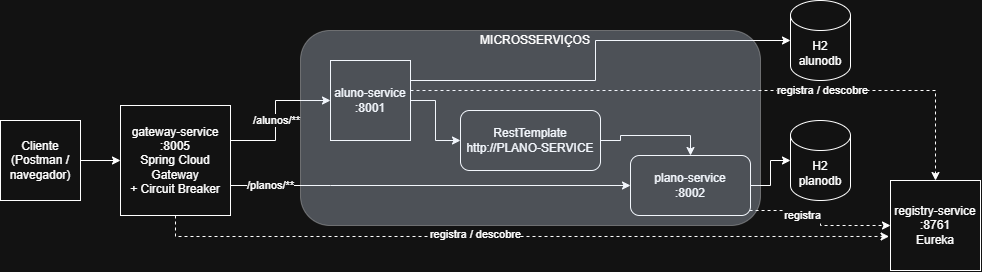

# Trabalho Grau B - Academia

Felipe e Lucas

Sistema de academia com microsservicos. Tem cadastro de planos e de alunos, e cada aluno tem um plano.



## Servicos

- registry-service (8761) - Eureka
- gateway-service (8005) - Gateway com circuit breaker
- aluno-service (8001) - alunos
- plano-service (8002) - planos

## Como rodar

Rodar nessa ordem: registry, plano, aluno, gateway.

## Testes (pelo gateway)

POST http://localhost:8005/planos
```json
{ "nome": "Mensal", "valorMensal": 99.90 }
```

POST http://localhost:8005/alunos
```json
{ "nome": "Joao", "cpf": "12345678900", "idade": 22, "planoId": 1 }
```

GET http://localhost:8005/alunos

GET http://localhost:8005/planos
